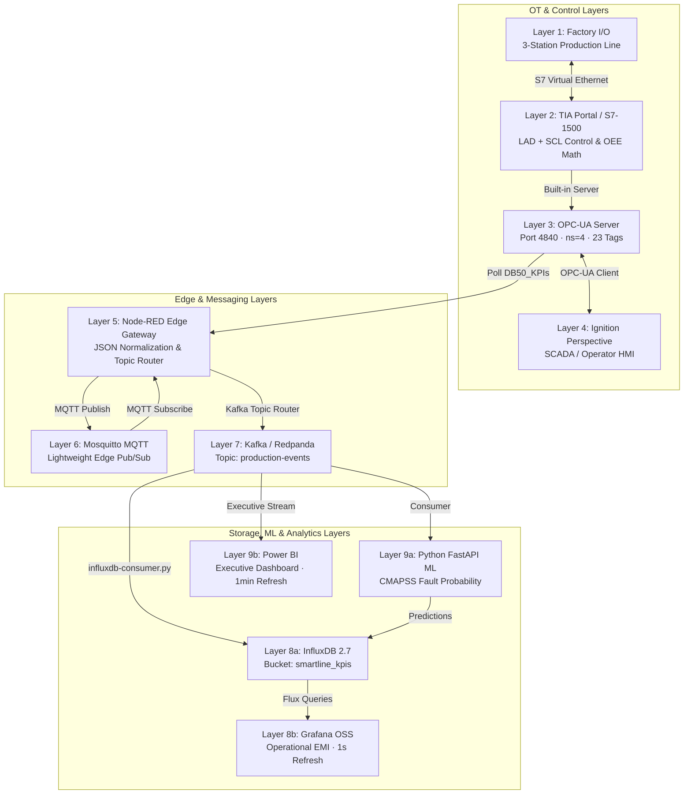
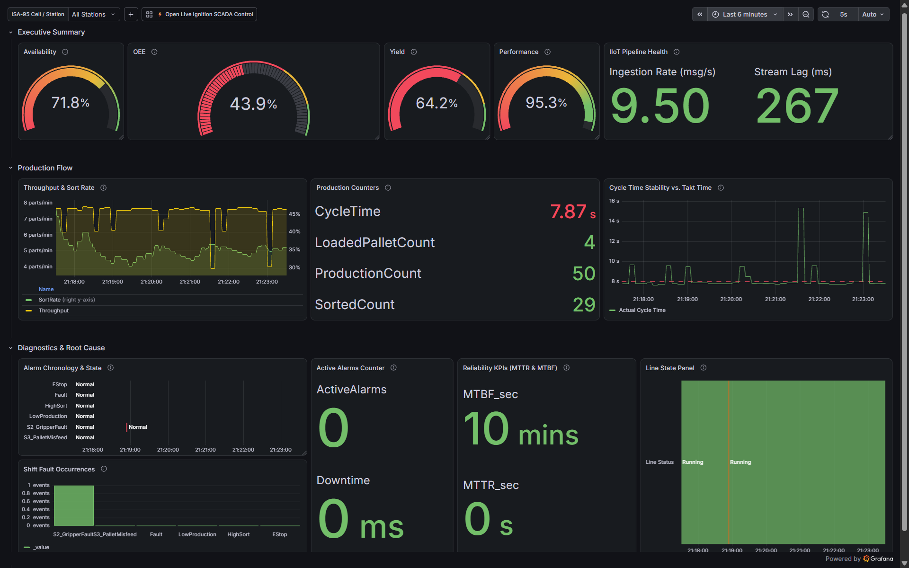
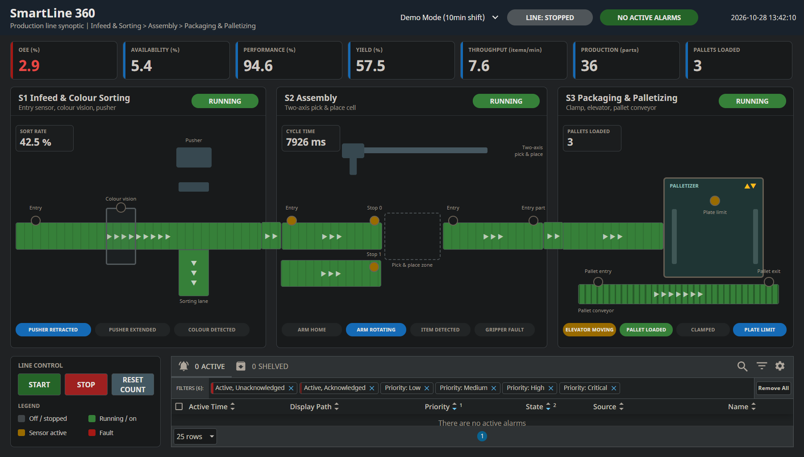

<div align="center">

# SmartLine 360

### Digital Factory Intelligence Platform

*Complete Industry 4.0 OT-IT architecture — from S7-1500 PLC control to executive dashboard*

[](https://opensource.org/licenses/MIT)
[](https://github.com/youness-tebbaq/SmartLine-360)
[](https://python.org)
[](https://docker.com)
[](https://kafka.apache.org)
[](https://influxdata.com)
[](https://grafana.com)
[](https://powerbi.microsoft.com)
[](https://nodered.org)

**[Architecture](#system-architecture)** · **[Quick Start](#quick-start)** · **[Tech Stack](#technology-stack)** · **[Docs](#documentation)**
</div>

---

## Table of Contents

- [Overview](#overview)
- [System Architecture](#system-architecture)
- [Technology Stack](#technology-stack)
- [Key Features](#key-features)
- [Project Metrics](#project-metrics)
- [Quick Start](#quick-start)
- [Repository Structure](#repository-structure)
- [Documentation](#documentation)
- [Dashboards](#dashboards)
- [Roadmap](#roadmap)
- [About This Project](#about-this-project)
- [Author](#author)
- [License](#license)

---

## Overview

**SmartLine 360** is a reference implementation of a complete Industry 4.0 data pipeline built around a simulated 3-station production line (**Infeed & Sorting -> Pick-and-Place Assembly -> Packaging & Palletizing**). It demonstrates the full **OT-IT integration stack** — from deterministic S7-1500 PLC logic and step watchdog protection to predictive maintenance AI and executive-level analytics — running on a single laptop.

The project was built to answer one operational question:

> *"When a crooked part jams a robot gripper on the shop floor, how long until the operator knows? The engineer? The CEO?"*

The answer spans **9 technologies across the OT-IT stack**, delivering **263 ms measured stream lag** in Grafana for operators and engineers, and a **60-second refresh cycle** in Power BI for executive reporting.

### Context

This project was developed as part of the **Master's in Industrial Technologies for the Factory of the Future (TIUF)** at [UM6P — Green Tech Institute (GTI)](https://um6p.ma/en/masters-degree-industrial-technologies-factory-future-en), Ben Guerir, Morocco. It serves both as a technical portfolio and as a practical reference for industrial OT-IT integration patterns.

---

## System Architecture

The system is organized into **9 layers** spanning physical simulation, deterministic PLC control, edge protocol translation, event streaming, and multi-audience visualization.



---

### Data Flow Summary

| From | To | Protocol / Mechanism | Rate / Cadence | Typical / Measured Latency |
|------|----|----------------------|----------------|----------------------------|
| Factory I/O | S7-1500 (PLCSIM Adv.) | S7 ISO-on-TCP (Virtual Adapter) | Cyclic scan | ~2 ms |
| S7-1500 (`DB50_KPIs`) | OPC-UA Server (`ns=4`) | Native S7-1500 OPC-UA (Port 4840) | 500 ms | ~5 ms |
| OPC-UA Server | Ignition SCADA | OPC-UA Subscription | 500 ms | Sub-second |
| OPC-UA Server | Node-RED | OPC-UA Read (`DB50_KPIs`) | 500–1000 ms | ~10 ms |
| Node-RED | Mosquitto MQTT | MQTT Publish (`SmartLine360/#`) | Event / Poll | ~5 ms |
| Mosquitto MQTT | Kafka / Redpanda | Node-RED `Kafka Topic Router` | Continuous (`production-events`) | ~12 ms |
| Kafka / Redpanda | InfluxDB (`smartline_kpis`) | `influxdb-consumer.py` | Continuous | ~18 ms |
| InfluxDB | Grafana Operational EMI | Flux Queries (State Timeline + Pareto) | 1 s refresh | **263 ms stream lag** |
| Pipeline | Power BI Executive | Executive aggregation | 60 s refresh | Up to 60 s |

---

## Technology Stack

| Layer | Technology | Role | License |
|-------|------------|------|---------|
| **1. Simulation** | [Factory I/O](https://factoryio.com) | 3-station 3D physics simulation (Sorting, Gantry Pick-and-Place, Palletizer) | 30-day trial |
| **2. PLC Control** | [Siemens TIA Portal V18 (S7-1500 + PLCSIM Adv.)](https://www.siemens.com/tia-portal) | IEC 61131-3 control (LAD), step watchdogs, and deterministic OEE/MTBF/MTTR math (`FC50_KPIs` in SCL) | Trial |
| **3. Protocol Bridge** | OPC-UA (`ns=4`, Port `4840`) | Exposes 23 typed PLC tags with source timestamps and quality flags | Built-in |
| **4. SCADA / HMI** | [Ignition 8.x (Perspective)](https://inductiveautomation.com) | ISA-101 operator synoptic, 3-state color priority bindings, alarm acknowledgment | Trial / Maker |
| **5. Edge Gateway** | [Node-RED](https://nodered.org) | Polls `DB50_KPIs`, normalizes payloads to JSON, and bridges MQTT to Kafka | Open Source |
| **6. Edge Broker** | [Eclipse Mosquitto MQTT](https://mosquitto.org) | Lightweight pub/sub ingestion at the edge (Port `1883`) | Open Source |
| **7. Event Streaming** | [Apache Kafka / Redpanda](https://redpanda.com) | Durable, replayable event log on unified topic `production-events` (Port `9092`) | Open Source |
| **8. Historian & Ops EMI** | [InfluxDB 2.7](https://influxdata.com) + [Grafana OSS](https://grafana.com) | Time-series bucket (`smartline_kpis`) + 1s operational dashboard with `$Station` filter | Open Source |
| **9. ML & Executive BI** | [Python FastAPI](https://fastapi.tiangolo.com) + [Power BI](https://powerbi.microsoft.com) | Random Forest fault probability (NASA CMAPSS) + 3-page management report | Free |

---

## Key Features

### OT & Control Layer (Factory I/O + S7-1500)
- **3 ISA-95 Work Cells**:
  - **Station 1 (Infeed & Sorting)**: Optical sensors detect parts; pneumatic diverters and turntables route items (`SortedCount`, `SortRate`, `HighSort` alarm).
  - **Station 2 (Pick-and-Place Assembly)**: Overhead gantry robot with vacuum gripper (`CycleTime`, `Throughput`). Protected by a step watchdog that raises `S2_GripperFault` and forces `DB50_KPIs.Throughput := 0.0` during a gripper jam (resolving the `7.81 s` sample-and-hold blind spot).
  - **Station 3 (Packaging & Palletizing)**: Roller conveyors (`DO_S3_Roller4m_B`) and a vertical palletizer elevator (`S3_Palletizer`) protected by a positive seating interlock (`DI_S3_PalletLoaded` on `%I2.1`) and a 6-second `TON` watchdog (`Alarm_S3_PalletMisfeed`) to prevent empty elevator ghost cycles.
- **Deterministic PLC KPI Engine (`FC50_KPIs` & `DB50_KPIs` in SCL)**:
  - Calculates `Availability`, `Performance`, `Yield`, and `OEE` directly inside the S7-1500 using retentive memory (`Retain`).
  - Separates **Machine Fault Reset** (`#Button_FaultReset`) from **End-of-Shift Reset** (`#HMI_ShiftReset`) so clearing an E-Stop or jam does not wipe shift OEE.
  - Uses rising-edge detection (`R_TRIG`) on fault transitions to compute **MTBF** and **MTTR** with division-by-zero protection.
- **4 Ignition Perspective SCADA Screens**: Production Overview (with 3-state priority color binding), Live KPIs, Alarm Management (acknowledge/shelve), and 24h Historian Trends.

### Edge & Streaming Layer (OPC-UA -> Node-RED -> MQTT -> Kafka)
- **OPC-UA Contract (`ns=4`)**: 23 structured tags validated in UaExpert on port `4840`.
- **Decoupled Node-RED Flows (`nod-red-flows/`)**: Reads `DB50_KPIs` via OPC-UA, formats structured JSON to Mosquitto MQTT, and routes edge messages via `Kafka Topic Router` into the unified `production-events` topic on port `9092`.
- **Kafka-to-InfluxDB Consumer (`influxdb-consumer.py`)**: Python consumer at the project root that subscribes to `production-events` and writes timestamped points into InfluxDB (`smartline_kpis`).

### Analytics & ML Layer (InfluxDB, Grafana, FastAPI, Power BI)
- **Dual-Panel Fault Diagnostics in Grafana (`dashboards/`)**: Pairs a continuous **Alarm Chronology & State** timeline (raw boolean state tracking with merged consecutive states) beside a **Shift Fault Occurrences (Pareto)** bar chart (Flux `difference(nonNegative: true) |> sum()` rising-edge counter), complete with an ISA-95 `$Station` dropdown (`All`, `S1`, `S2`, `S3`) and a deep-link button to Ignition SCADA.
- **Predictive Maintenance Service**: Random Forest model trained on NASA's CMAPSS turbofan degradation dataset (split by engine unit to avoid time-series leakage), served via FastAPI.
- **Power BI Executive Report (`power-bi/`)**: 3 pages (Shift Overview, Weekly Benchmark, Quality Analysis) refreshing every 60 seconds.

---

## Project Metrics

| Metric | Value |
|--------|-------|
| PLC CPU & Logic | Siemens S7-1500 (`LAD` + `SCL` in `FC50_KPIs` / `DB50_KPIs`) |
| OPC-UA Server | Port `4840`, Namespace `ns=4`, 23 structured tags at `500 ms` |
| Supervised Watchdog Alarms | `HighSort` (S1), `S2_GripperFault` (S2), `Alarm_S3_PalletMisfeed` (S3, `6 s` TON), `Alarm_EStop` |
| Edge Polling & Transport | Node-RED (`500–1000 ms`) -> Mosquitto (`1883`) -> Kafka/Redpanda (`9092`, topic `production-events`) |
| Time-Series Historian | InfluxDB 2.7 (`org: um6p`, `bucket: smartline_kpis`) via `influxdb-consumer.py` |
| Measured Grafana Stream Lag | **263 ms** (1s operational dashboard refresh) |
| Executive BI Refresh | **60 seconds** (Power BI) |
| ML Alert Threshold | $70\%$ fault probability (NASA CMAPSS engine-unit split) |

---

## Quick Start

### Prerequisites

| Tool | Version | Notes |
|------|---------|-------|
| Docker + Docker Compose | Latest | For Mosquitto, Redpanda, InfluxDB, Grafana |
| Python | 3.11+ | For `influxdb-consumer.py` and FastAPI ML service |
| Node.js | 18+ | Node-RED runtime |
| TIA Portal + PLCSIM Advanced | V18 (trial) | S7-1500 PLC programming & virtual ethernet |
| Factory I/O | 30-day trial | 3D process simulation |
| Ignition | 8.x (trial/maker) | SCADA/HMI |

### 1 — Clone the repository

```bash
git clone https://github.com/youness-tebbaq/SmartLine-360.git
cd SmartLine-360
```

### 2 — Start the Docker IT stack (Mosquitto, Redpanda, InfluxDB, Grafana)

```bash
cd docker
docker compose up -d
docker compose ps
```

Services started:

| Service | URL / Port | Credentials / Details |
|---------|------------|-----------------------|
| Grafana | `http://localhost:3000` | `admin` / `smartline` |
| InfluxDB | `http://localhost:8086` | `admin` / `smartline2026` (`org: um6p`, `bucket: smartline_kpis`) |
| Mosquitto MQTT | `localhost:1883` | Anonymous local edge access |
| Redpanda (Kafka API) | `localhost:9092` | Topic: `production-events` |

### 3 — Configure Virtual Network & Start PLC / Factory I/O

1. In Windows Network Connections (`ncpa.cpl`), assign the static IPv4 address `192.168.0.50` (subnet `255.255.255.0`) to the **Siemens PLCSIM Virtual Ethernet Adapter**.
2. Start **S7-PLCSIM Advanced** (`192.168.0.1`), open the project in `plc-programs/` in TIA Portal, and download the S7-1500 program (OPC-UA server enabled on port `4840`).
3. Open the scene in `factory-io-scenes/` in Factory I/O, connect the Siemens S7-1200/1500 driver, and switch to Run Mode.

### 4 — Start Node-RED, InfluxDB Consumer & Ignition

1. Start Node-RED (`http://localhost:1880`), import the flow from `nod-red-flows/`, and click **Deploy**.
2. From the project root, start the Kafka-to-InfluxDB consumer:
   ```bash
   python influxdb-consumer.py
   ```
3. Open Ignition Gateway (`http://localhost:8088`) and import the project from `ignition-projects/`.

For detailed instructions see [`docs/SETUP.md`](docs/SETUP.md) and [`docs/DEPLOYMENT.md`](docs/DEPLOYMENT.md).

---

## Repository Structure

```text
SmartLine-360/
│
├── assets/                            # Architecture diagrams, screenshots & demo recordings
│   └── screenshots/                   # Dashboard and HMI captures
│
├── dashboards/                        # Exported Grafana dashboard JSON models & configs
│
├── docker/                            # Infrastructure as Code
│   └── docker-compose.yml             # Mosquitto, Redpanda, InfluxDB 2.7, and Grafana
│
├── docs/                              # Full engineering & project management documentation
│   ├── ARCHITECTURE.md                # 9-layer OT-IT design decisions and data flow
│   ├── DEPLOYMENT.md                  # Docker Compose and startup sequence
│   ├── DEVELOPMENT.md                 # How to modify and extend the project
│   ├── KPI_GUIDE.md                   # FC50_KPIs SCL formulas and DB50_KPIs tag map
│   ├── LESSONS_LEARNED.md             # Technical notes, code walkthroughs & debugging log
│   ├── PROJECT_CHARTER.md             # Project scope, stakeholders, and constraints
│   ├── RISK_REGISTER.md               # Tracked technical and operational risks
│   ├── SETUP.md                       # Complete step-by-step installation guide
│   ├── TROUBLESHOOTING.md             # Layer-by-layer diagnostic runbook
│   └── WORK_BREAKDOWN_STRUCTURE.md    # M1-M4 milestone breakdown
│
├── factory-io-scenes/                 # 3-station Factory I/O simulation scene (.factoryio)
│
├── ignition-projects/                 # Ignition Perspective SCADA exports (4 HMI screens)
│
├── nod-red-flows/                     # Node-RED edge flows (OPC-UA -> Mosquitto -> Kafka)
│
├── plc-programs/                      # Siemens S7-1500 TIA Portal project (LAD + SCL)
│
├── plc-programs.backup/               # Dated TIA Portal project backups (Risk R1 mitigation)
│
├── power-bi/                          # Executive Power BI dashboard files (.pbix)
│
├── .gitignore                         # Git ignore rules for TIA caches and .env secrets
├── influxdb-consumer.py               # Python Kafka consumer writing to InfluxDB (smartline_kpis)
├── LICENSE                            # MIT License
├── README.md                          # Project overview (you are here)
└── Repository Structure.txt           # Quick directory tree reference
```

---

## Documentation

| Document | Description |
|----------|-------------|
| [`docs/ARCHITECTURE.md`](docs/ARCHITECTURE.md) | Detailed architecture decisions, protocol choices (OPC-UA vs MQTT, MQTT vs Kafka), and 3-station process design |
| [`docs/KPI_GUIDE.md`](docs/KPI_GUIDE.md) | Complete reference for `FC50_KPIs` (SCL) and `DB50_KPIs`, including OEE, MTBF, MTTR, and watchdog alarms |
| [`docs/LESSONS_LEARNED.md`](docs/LESSONS_LEARNED.md) | Deep dive into virtual PLC networking, Docker Compose, Node-RED JSON formatting, and resolved commissioning bugs |
| [`docs/SETUP.md`](docs/SETUP.md) | Prerequisites, step-by-step installation for all components, and virtual network adapter configuration |
| [`docs/DEPLOYMENT.md`](docs/DEPLOYMENT.md) | Running the full stack in order, environment variables, and verification checks |
| [`docs/DEVELOPMENT.md`](docs/DEVELOPMENT.md) | Adding new sensors/tags, extending the ML model, and creating new Grafana panels |
| [`docs/TROUBLESHOOTING.md`](docs/TROUBLESHOOTING.md) | Virtual network subnet fixes, OPC-UA connection issues, Flux query pitfalls, and Ignition alarm diagnostics |

---

## Dashboards

### Grafana — Operational Dashboard (factory floor, 1s refresh)



Panels:
- **OEE Gauge** — current shift OEE with threshold coloring (red $< 65\%$, amber $< 80\%$, green $\ge 80\%$)
- **ISA-95 `$Station` Filter & SCADA Deep-Link** — dynamic filtering (`All Stations`, `S1`, `S2`, `S3`) and direct button into Ignition HMI
- **Cycle Time vs. Target Takt & Throughput Trends** — live bottleneck detection (`263 ms` stream lag)
- **Alarm Chronology & State (State Timeline)** — continuous Gantt-style tracking (`0` = Normal, `1` = Fault Active)
- **Shift Fault Occurrences (Pareto)** — Flux rising-edge (`0 -> 1`) event counter isolating frequent micro-stops
- **Fault Probability** — ML model output $0\text{--}100\%$, turns red above $70\%$

### Power BI — Executive Dashboard (management, 1min refresh)


Pages:
- **Shift Overview** — planned vs actual production, OEE, downtime minutes
- **Weekly Benchmark** — OEE trend, best/worst shift analysis
- **Quality Analysis** — sorting/diversion distribution by hour and station

### Ignition SCADA — Operator HMI



Screens:
- **Production Overview** — live conveyor synoptic with 3-state color priority (`#FF0000` Fault, `#43A047` Running, `#B0B7C0` Idle)
- **KPI Screen** — real-time counters, cycle time, OEE gauge
- **Alarm Screen** — active alarm list (`Alarm_S3_PalletMisfeed`, `S2_GripperFault`, `HighSort`, `Alarm_EStop`), acknowledge/shelve
- **Trend Screen** — 24-hour historian trends for any tag

---

## Roadmap

| Status | Feature |
|--------|---------|
| Done | S7-1500 PLC program — LAD control + SCL `FC50_KPIs` / `DB50_KPIs` OEE & MTBF/MTTR math |
| Done | Factory I/O 3-station scene + OPC-UA server (`ns=4`, port `4840`) |
| Done | Ignition Perspective SCADA screens + 3-state priority bindings |
| Done | Node-RED OPC-UA polling -> Mosquitto MQTT -> Kafka (`production-events`) |
| Done | `influxdb-consumer.py` + InfluxDB (`smartline_kpis`) + Grafana operational EMI dashboard |
| In progress | Python FastAPI ML service — predictive maintenance (NASA CMAPSS) |
| In progress | Power BI executive dashboard |
| Planned | IEC 62443 OT network segmentation diagram |
| Planned | End-to-end split-screen demo video |

---

## About This Project

**Key engineering decisions documented:**

- **Why compute OEE in the S7-1500 PLC instead of Node-RED?** Computing Availability, Performance, Yield, OEE, MTBF, and MTTR inside `FC50_KPIs` (SCL) using retentive memory (`DB50_KPIs`) provides a single deterministic source of truth across Ignition, Grafana, and Power BI, and preserves shift metrics if an IT container restarts.
- **Why OPC-UA at the OT layer, not MQTT?** OPC-UA provides a structured information model with typed variables (`ns=4`), source timestamps, and quality flags. MQTT is used after the Node-RED edge gateway for lightweight pub/sub distribution.
- **Why Kafka/Redpanda in addition to MQTT?** Multiple downstream consumers (`influxdb-consumer.py`, FastAPI ML, Power BI) read from the `production-events` stream independently. Kafka's commit log allows each consumer group to track its own offset and replay missed events after downtime.
- **Why pair a State Timeline with a Pareto chart in Grafana?** A rising-edge Pareto bar chart (`difference(nonNegative: true) |> sum()`) identifies what breaks most often across a shift, while a raw State Timeline displays active latched faults and exact failure timestamps.

---

## 👨‍💻 Author

**Youness Tebbaq**

Master's student in Industrial Technologies for the Factory of the Future (TIUF)
UM6P · Green Tech Institut (GTI) · Ben Guerir, Morocco

| | |
|--|--|
| 📧 | youness.tebbaq1@gmail.com |
| 💼 | [linkedin.com/in/youness-tebbaq-135634276](https://www.linkedin.com/in/youness-tebbaq-135634276) |
| 📍 | Casablanca, Morocco |
| 🎯 | Industrial automation / IIoT |

**Other projects and experience:**
- 🚗 Embedded BMS monitoring system — STM32 + CAN bus — Renault Arkana Hybrid (Internship, M-AUTOMOTIV)
- 🏭 Industrial heating system automation — PLC Zelio + FAT/SAT validation (Internship, Procter & Gamble)
- 🤖 3D parametric robot modelling — SolidWorks (CSWA certified)
- 📊 Discrete-event simulation — Chromium plating line — Arena + Power BI KPI dashboard

---

## 🙏 Acknowledgements

- [Inductive Automation](https://inductiveautomation.com) — Ignition free demo + Ignition Core Certification
- [NASA AMES](https://ti.arc.nasa.gov/tech/dash/groups/pcoe) — CMAPSS Turbofan Degradation Dataset (public domain)
- [HiveMQ](https://hivemq.com) — MQTT Essentials educational resources
- [Factory I/O](https://factoryio.com) — Realistic PLC simulation platform

---

## 📄 License

This project is licensed under the **MIT License** — see the [LICENSE](LICENSE) file for details.

You are free to use, modify, and distribute this project for educational and non-commercial purposes. Attribution appreciated.

---

<div align="center">

*Built with purpose by a student who believes that the best way to learn IIoT is to build the whole stack, not just the parts.*

⭐ **If this project helped you understand industrial IoT architecture, consider starring the repository.**

</div>