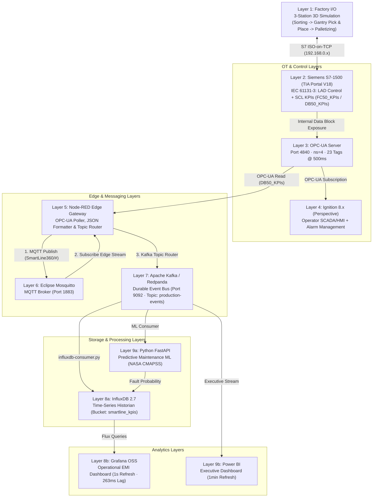

# Architecture — SmartLine 360

Digital Factory Intelligence Platform: a complete OT-IT pipeline from a
simulated S7-1500 PLC-controlled production line to operational and business
dashboards, built on 9 technologies across 9 architectural layers.

## Table of Contents
- [System Overview](#system-overview)
- [Architecture Diagram](#architecture-diagram)
- [Layer-by-Layer Breakdown](#layer-by-layer-breakdown)
- [Physical Process Design](#physical-process-design)
- [Data Flow — Step by Step](#data-flow--step-by-step)
- [Design Decisions](#design-decisions)
- [Repository Mapping](#repository-mapping)

---

## System Overview

SmartLine 360 simulates a 3-station production line (**Infeed & Sorting ->
Pick-and-Place Assembly -> Packaging & Palletizing**) controlled by a virtual
**Siemens S7-1500 PLC (S7-PLCSIM Advanced)** and pipes its operational telemetry
through a full OT-to-IT stack in real time:

```text
Factory I/O (Physics) -> S7-1500 PLC (Control & OEE) -> OPC-UA (ns=4) -> Ignition SCADA
                                                            |
Power BI + FastAPI ML <- Grafana <- InfluxDB <- Kafka/Redpanda <- Mosquitto MQTT <- Node-RED
```

Everything runs on a single laptop (16 GB RAM) using free or trial tools —
no physical hardware required.

---

## Architecture Diagram



---

## Layer-by-Layer Breakdown

| # | Layer | Technology | Role |
| - | --- | --- | --- |
| 1 | Simulation | Factory I/O | Simulates the physical production line: roller conveyors, optical sensors, pneumatic diverters, gantry robot, and palletizer elevator. Exposes every sensor and actuator as an I/O tag. |
| 2 | Control & OEE Math | TIA Portal (S7-1500 + PLCSIM Adv.) | Executes deterministic LAD control, step watchdogs, and `FC50_KPIs` (SCL) to compute OEE, Availability, Performance, Yield, MTBF, and MTTR in `DB50_KPIs`. |
| 3 | Protocol Bridge | OPC-UA (`ns=4`, Port `4840`) | Industrial-standard server exposing 23 typed PLC tags with timestamps and quality flags to any client without custom drivers. |
| 4 | SCADA/HMI | Ignition (Perspective) | Provides an ISA-101 human-operable synoptic with 3-state priority color bindings and alarm acknowledgment (`Alarm_S3_PalletMisfeed`, `S2_GripperFault`). |
| 5 | Edge Integration | Node-RED (`nod-red-flows/`) | Polls `DB50_KPIs` via OPC-UA, formats values into structured JSON, publishes to Mosquitto MQTT, and routes messages into Kafka. |
| 6 | Edge Broker | Mosquitto MQTT | Lightweight pub/sub broker at the edge (`localhost:1883`) for sub-second state updates. |
| 7 | Event Streaming | Kafka / Redpanda | Durable commit log on unified topic `production-events` (`localhost:9092`), enabling independent consumer offset tracking and replay. |
| 8 | Historian & Ops EMI | InfluxDB 2.7 + Grafana (`dashboards/`) | `influxdb-consumer.py` writes high-frequency time-series points into `smartline_kpis`; Grafana renders 1-second operational panels (State Timeline + Pareto) with `263 ms` measured stream lag. |
| 9 | Business BI + ML | Power BI + Python FastAPI | Serves a Random Forest fault probability score ($0\text{--}100\%$) trained on NASA CMAPSS and aggregates 60-second shift KPIs for management. |

---

## Physical Process Design

The Factory I/O scene models 3 sequential ISA-95 work cells controlled by the S7-1500 PLC:

1. **Station 1 — Infeed & Sorting**: Raw workpieces enter the main conveyor where optical sensors detect part presence and physical profile. Pneumatic diverters and turntables route valid workpieces toward assembly while diverting alternate items, updating `SortedCount` and `SortRate`. If diversion exceeds normal thresholds, the PLC raises the `HighSort` alarm.
2. **Station 2 — Pick-and-Place Assembly**: A multi-axis overhead gantry robot picks parts from a parallel feed conveyor using a pneumatic vacuum gripper and places them onto the main transfer line, updating `CycleTime` and `Throughput`. A step watchdog timer supervises the motion sequence: if a crooked workpiece blocks the gripper mid-cycle, it triggers `S2_GripperFault` and forces `DB50_KPIs.Throughput := 0.0`.
3. **Station 3 — Packaging & Palletizing**: Empty pallets advance along roller conveyor `DO_S3_Roller4m_B` into the vertical palletizer elevator `S3_Palletizer`. The PLC verifies positive pallet seating via input sensor `%I2.1` (`"DI_S3_PalletLoaded"`) within a 6-second `TON` watchdog window before permitting vertical motion. If a pallet fails to clear the entry rollers, the PLC blocks the lift (preventing an empty elevator ghost cycle) and raises `Alarm_S3_PalletMisfeed`. Completed pallets increment `ProductionCount` and `LoadedPalletCount`.

---

## Data Flow — Step by Step

1. A workpiece moves through the 3-station line in Factory I/O; optical and seating sensors update their digital inputs over the virtual S7 connection (`192.168.0.x`).
2. The **S7-1500 PLC** (running on S7-PLCSIM Advanced) executes the station LAD blocks and calls `FC50_KPIs` (SCL) on every scan to update `DB50_KPIs` (`OEE`, `Availability`, `Performance`, `Yield`, `MTBF`, `MTTR`, and watchdog alarms).
3. The S7-1500's built-in **OPC-UA server** (`ns=4`, port `4840`) exposes 23 structured tags at a `500 ms` update rate.
4. **Ignition Perspective** subscribes to the OPC-UA server to drive the 4 operator HMI screens and evaluate alarm states.
5. **Node-RED** polls `DB50_KPIs` via OPC-UA, wraps each metric into a structured JSON payload with an ISO-8601 timestamp, and publishes to **Mosquitto MQTT** (`SmartLine360/<metric>`).
6. A second decoupled flow in Node-RED (`Listen to Mosquitto Edge` -> `Kafka Topic Router`) assigns `msg.topic = "production-events"` and forwards the stream into **Kafka / Redpanda** on `127.0.0.1:9092`.
7. The root Python consumer script (`influxdb-consumer.py`) reads from `production-events` and writes timestamped points into the **InfluxDB** `smartline_kpis` bucket, while the **FastAPI** Random Forest service scores equipment health.
8. **Grafana** queries `smartline_kpis` every second using Flux to display live gauges, the **Alarm Chronology & State** timeline, and the **Shift Fault Occurrences** Pareto chart.
9. **Power BI** refreshes every 60 seconds to aggregate shift production, OEE benchmarks, and quality distributions for management.

---

## Design Decisions

| Decision | Rationale |
| --- | --- |
| Compute OEE in the PLC (`FC50_KPIs`), not in Node-RED | Computing OEE, MTBF, and MTTR deterministically in SCL using retentive PLC memory (`DB50_KPIs`) provides a single source of truth across Ignition, Grafana, and Power BI, and preserves shift totals across edge restarts. |
| Separate Machine Fault Reset from Shift Reset | `#Button_FaultReset` clears latched alarms and actuators after an E-Stop or jam without modifying `DB50_KPIs`, while only `#HMI_ShiftReset` zeroes shift accumulators. |
| MQTT **and** Kafka, not just one | Mosquitto MQTT provides lightweight pub/sub at the edge; bridging into Redpanda/Kafka (`production-events`) adds durable log retention and independent consumer group offsets for `influxdb-consumer.py`, FastAPI ML, and Power BI. |
| Redpanda for local Kafka deployment | Kafka-API-compatible on port `9092` without JVM/Zookeeper overhead, fitting comfortably inside a 16 GB RAM laptop alongside TIA Portal and Factory I/O. |
| State Timeline + Pareto in Grafana | A rising-edge Pareto bar chart (`difference(nonNegative: true) |> sum()`) shows maintenance what breaks most often, while a raw State Timeline displays active latched alarms and failure timestamps. |

---

## Repository Mapping

| Repo Path | Layer(s) & Role |
| --- | --- |
| `factory-io-scenes/` | Layer 1: 3D Process Simulation (`.factoryio`) |
| `plc-programs/` | Layer 2 & 3: S7-1500 Control (`LAD` + `SCL`) & OPC-UA Server |
| `plc-programs.backup/` | Dated TIA Portal project backups (Risk R1 mitigation) |
| `ignition-projects/` | Layer 4: Perspective SCADA / HMI exports |
| `nod-red-flows/` | Layer 5, 6 & 7: OPC-UA -> Mosquitto MQTT -> Kafka (`production-events`) |
| `docker/` | Layer 6, 7 & 8: `docker-compose.yml` (Mosquitto, Redpanda, InfluxDB, Grafana) |
| `influxdb-consumer.py` | Layer 7 -> 8 Bridge: Python Kafka consumer writing to InfluxDB (`smartline_kpis`) |
| `dashboards/` | Layer 8b: Exported Grafana operational dashboard JSON models |
| `power-bi/` | Layer 9: Executive Power BI Dashboard (`.pbix`) |
| `docs/` | Project management and engineering documentation |
| `assets/` | Architecture diagrams, screenshots, and demo recordings |