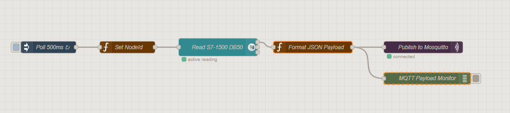

# Lessons Learned: SmartLine-360 Architecture and Core Concepts

This document serves as the master reference guide for the SmartLine-360 project. It synthesizes all core concepts in Industrial IoT (IIoT), Operational Technology (OT), Information Technology (IT), and the architectural decisions made during the project's lifecycle.

---

## 1. Data Streaming & Pipeline Architecture

### What is Data Streaming?
A data streaming platform acts as the central nervous system for your factory's data. Instead of storing data in a local file and moving it later, a streaming platform (like a highly efficient digital post office) catches incoming messages from machinery, organizes them into categories (topics), and instantly routes them to any subscribed system. 

<<<<<<< HEAD
### Streaming vs. Batch Processing (The SmartLine-360 Context)
*   **Batch Processing (The Bucket):** Data is collected over a period of time and moved all at once. For example, downloading a CSV file of Station 1's color sorting rejects at the end of an 8-hour shift.
*   **Data Streaming (The River):** Data moves continuously, event-by-event, the exact millisecond it is generated. 
*   **Why SmartLine-360 Needs Streaming:** Physical machinery requires immediate reactions. If a pallet jams on the Station 3 conveyor or the Station 2 gripper fails, an alert must trigger in milliseconds. Batch processing would tell you about a jam hours after it ruined production; data streaming provides the ultra-low latency required to light up the `BeltJam` alarm on your Grafana dashboard instantly.
=======
## M3 — IT/Data Pipeline
- **What went well:**
- **What went wrong / took longer than expected:**
- **What I'd do differently:**
- **Technical learning worth remembering:** 
  - **Architectural Decoupling:** Connecting IT applications directly to the PLC risks overloading the OT network. Using a middle messaging layer protects the physical production line from heavy IT queries.
  - **MQTT (The Environment):** Serves as a lightweight edge "bulletin board" ideal for constrained industrial networks. It allows the architecture to bypass the PLC for non-control IIoT data.
  - **Node-RED (The Worker):** Acts as the active edge gateway. It translates heavy OPC-UA polling into IT-friendly JSON, computes edge logic (like OEE), and bridges the gap by pushing local MQTT data to the enterprise Kafka stream.
  - **Broker Bridging:** MQTT and Kafka cannot talk directly because they are both passive brokers using different protocols. Node-RED is required as the active client to read from MQTT and act as a producer to push data to Kafka.
>>>>>>> f89c2a6ebf537adacd0eaefed1eb21875f8ff7fe

### Apache Kafka vs. Redpanda
Both platforms do the exact same job (data streaming brokers) and speak the exact same protocol. 
*   **Apache Kafka:** The heavy-duty industry standard used by massive enterprises. It runs on Java and requires high memory (RAM).
*   **Redpanda:** A modern, lightweight clone built in C++. It delivers enterprise-level data routing without crashing a standard computer due to memory limits, making it ideal for edge deployment in SmartLine-360.
> 💡 **Career Strategy:** The job market looks for "Apache Kafka" skills. Because they are identical in operation, list **Apache Kafka** on your CV, and note: *"Implemented an Apache Kafka data streaming architecture (using Redpanda for lightweight edge deployment)."*

### Latency and Cycle Time
*   **Latency:** The travel time of your data. It is the fraction of a second it takes for an electrical signal to travel from the S7-1500 PLC, through Node-RED and Redpanda, to update the dashboard. "Ultra-low latency" means pushing this delay as close to zero as possible.
*   **Cycle Time:** The exact duration between two consecutive finished products leaving the final station (Station 3).

---

## 2. Time-Series Data & Timestamps (The Single Source of Truth)

Timestamps are critical for accurate OEE and cycle time calculations, but there is a "décalage" (offset) between different systems.

*   **The PLC Timestamp (The Birth Certificate):** In OB1, the `RD_LOC_T` block records the exact millisecond a physical event happens (e.g., a pallet hitting the exit sensor). This is the absolute physical truth.
*   **The Kafka Timestamp (The Postmark):** When the message finally arrives at the Redpanda broker over the network, it gets an "append time."
*   **The Décalage:** The time gap between the PLC timestamp and the Kafka timestamp is your network latency. 
*   **The Solution:** InfluxDB (your Time-Series Database) must be configured to use the **PLC Timestamp** to index the data. If you use the Kafka timestamp, network lag will distort your cycle time calculations, making your physical machines look inconsistent when it is actually just IT network traffic.

---

## 3. Data Consumption & The Decoupling Principle

SmartLine-360 splits data visualization into two distinct paths to protect the system.

### Path A: Grafana + InfluxDB (Operational Path)
*   **Role:** The Operator's Steering Wheel.
*   **Mechanism:** Grafana *pulls* historical and live data from InfluxDB.
*   **Requirement:** Operators need a 1-second refresh rate. InfluxDB is a Time-Series Database specifically engineered to serve massive amounts of timestamped sensor data instantly without choking.

### Path B: Power BI + Streaming API (Executive Path)
*   **Role:** The Manager's Rearview Mirror.
*   **Mechanism:** Power BI uses a Push Strategy. A custom script (`powerbi-consumer`) listens directly to the Redpanda/Kafka stream and *pushes* live JSON data into Power BI's Streaming Dataset API.
*   **The Decoupling Principle:** Executives run heavy historical calculations (e.g., monthly yield vs. financial targets). If Power BI ran these massive queries directly on InfluxDB, it would consume all the database's processing power, freezing Grafana's 1-second refresh on the factory floor. Bypassing the database and reading directly from the streaming broker keeps the IT reporting layer completely decoupled from the OT operational layer.

---

## 4. The 3-Layer Architecture & Protocols

SmartLine-360 relies on an unbroken chain of communication to move data from the factory floor to the cloud.

### The Protocol Bridge
*   **OPC-UA (The Factory Floor Workhorse):** Direct, highly secure communication between the PLC and SCADA (Ignition). Uses a rigid, hierarchical tag structure. Heavy, but perfect for physical safety and control.
*   **MQTT (The Edge-to-Cloud Connector):** Lightweight, fast messaging protocol built for IoT. Uses a "Publish/Subscribe" model where sensors shout out data, and any system that cares can listen.
*   **Node-RED (The Translator):** Because PLCs speak OPC-UA and databases/brokers speak MQTT, Node-RED acts as the edge gateway, translating real-time OT data into IT-friendly JSON payloads.

### The Data Flow Sequence
`PLC (S7-1500) ➔ OPC-UA Server ➔ Node-RED ➔ MQTT Broker ➔ Kafka/Redpanda ➔ InfluxDB ➔ Grafana`

---

## 5. OT Foundation: PLC Programming & Commissioning

### PLCSIM vs. PLCSIM Advanced
*   **Standard PLCSIM:** Great for internal testing, but lives in a closed box.
*   **PLCSIM Advanced:** Creates a virtual network adapter. It tricks Factory I/O, Node-RED, and Ignition into believing a physical hardware PLC is connected via an IP address. Switching to the S7-1500 was mandatory to expose the OPC-UA server externally.

### LAD vs. SCL Programming
*   **Ladder Logic (LAD):** Visual (electrical contacts/coils). Best for physical hardware control (Start buttons, E-Stops, motor interlocks). Easy for maintenance technicians to troubleshoot.
*   **Structured Control Language (SCL):** Text-based math. Best for complex data arrays and KPI calculations (`FC50_KPIs`).

### PLC Memory Strategy (Retain Policy)
*   **Retain = Yes:** Used for raw, accumulating counters (e.g., `ProductionCount`). Survives a power failure so shift data isn't lost.
*   **Retain = No:** Used for real-time computed KPIs (e.g., `OEE`, `Throughput`). Forces a fresh calculation upon restart.

### PLC Instruction Best Practices
*   **TON (On-Delay Timer):** Output Q goes to 1 only after the timer reaches PT *and* IN remains 1.
*   **CTU (Count Up):** Stores its value in an Instance DB. Reset using the `R` input, never by overwriting the `CV`.
*   **Edge Detection:** `P_TRIG` detects 0➔1 (rising edge); `N_TRIG` detects 1➔0 (falling edge).

### OEE (Overall Equipment Effectiveness)
OEE = Availability × Performance × Quality
*   **Availability:** Run Time / Planned Time
*   **Performance:** (Total Count × Ideal Cycle Time) / Run Time
*   **Quality:** Good Units / Total Units

---

## 6. IT Infrastructure & Deployment

### Docker Containerization
Docker is the deployment engine for the IT stack, providing a reproducible environment.
*   **Image:** The blueprint/recipe (e.g., the official Grafana file).
*   **Container:** The live, running application (the baked cake).
*   **Volumes:** The memory card. Saves InfluxDB data permanently so it survives container reboots.
*   **Docker Compose:** The master switch (`docker-compose up -d`) that starts Redpanda, InfluxDB, and Grafana simultaneously.

### Git & Version Control
*   **Git:** Version control on your local machine (a time machine for TIA Portal projects).
*   **GitHub:** Cloud hosting and portfolio proof.
*   **Best Practice:** Always use a `.gitignore` file to exclude TIA Portal caches, and use imperative commit messages (e.g., `feat(plc): add KPI calculation FC block`).

---

## 7. MQTT Protocol Deep Dive

### Quality of Service (QoS)
*   **QoS 0 (At most once):** "Fire and forget" (like a postcard). Best for rapid, non-critical sensor reads.
*   **QoS 1 (At least once):** Guaranteed delivery, but might duplicate (like certified mail).
*   **QoS 2 (Exactly once):** Slowest, but guarantees single delivery. Used for critical commands.

### Topics and Wildcards
Topics are the "address" on the envelope (e.g., `factory/station3/cycleTime`).
*   **`+` (Single-level):** `sensors/+/temp` matches `sensors/machineA/temp`
*   **`#` (Multi-level):** `sensors/#` matches everything under the sensors category.
*   **Best Practice:** Follow ISA-95 Unified Namespace (UNS) architecture: `Company/Site/Area/Line/Equipment/Tag`

### Retained Messages vs. Persistent Sessions
*   **Retained Message:** The broker saves the *last* message published to a topic so any *new* subscriber instantly knows the current state.
*   **Persistent Session:** The broker saves *all missed messages* for a specific client that temporarily disconnected (requires `CleanSession = false`).

### Sparkplug B
An industrial standard built on top of MQTT that enforces a rigid topic structure, mandates Google Protocol Buffers (Protobuf) for payload compression, and uses Birth/Death certificates to track device health.

---

## 8. Factory I/O & Hardware Components

### Sensors
*   **Diffuse:** Light reflects off the object (simple presence).
*   **Retroreflective:** Light bounces off a fixed reflector; objects break the beam (reliable regardless of object color).
*   **Vision:** Detects specific colors or shapes for quality sorting.

### SCADA vs. HMI
*   **HMI (Human-Machine Interface):** Localized to one machine. Operator-focused.
*   **SCADA (Supervisory Control and Data Acquisition):** Plant-wide. Manager-focused, handling advanced alarm routing and long-term historical logging (Ignition).

---

## 9. Smart Manufacturing Trends & Project Management

### Global Industry 4.0 Trends
*   **Unified Namespace (UNS):** Transitioning away from point-to-point integrations toward a single centralized MQTT broker for all factory data.
*   **Edge Computing:** Processing data directly at the machine layer (via Node-RED/Redpanda) rather than sending raw high-frequency signals to the cloud.

### Project Management (WBS)
SmartLine-360 was successfully executed using a 4-phase Work Breakdown Structure:
1.  **M1 - OT Foundation:** Factory I/O + TIA Portal S7-1500 logic.
2.  **M2 - SCADA & Integration:** Ignition HMI + OPC-UA mapping.
3.  **M3 - IT/Data Pipeline:** Docker + Redpanda + Node-RED + InfluxDB.
4.  **M4 - Visualization:** Grafana (Ops) + Power BI (Exec) Dashboards.

## 31. Building the IT Data Pipeline (Docker Compose)

### The Concept: Infrastructure as Code
Instead of installing databases and brokers manually on Windows (which causes software conflicts and dependency issues), Docker Compose allows you to define your entire IT infrastructure in a single text file (`docker-compose.yml`). When you run `docker compose up -d`, Docker downloads the images and starts the containers in isolated Linux environments. In SmartLine-360, this houses the Mosquitto MQTT broker, Redpanda Kafka broker, InfluxDB historian, and Grafana dashboard.

### Line-by-Line Code Explanation: `docker-compose.yml`

```yaml
version: '3.8' 
# Specifies the Docker Compose file format version.

services:
# Defines the individual containers (services) that make up your pipeline.

  # --- MQTT BROKER (Edge Ingestion) ---
  mosquitto:
    image: eclipse-mosquitto:2 
    # Pulls the official Eclipse Mosquitto version 2 image.
    container_name: smartline-mqtt 
    # Names the container so you can find it easily in your terminal.
    ports:
      - "1883:1883" 
      # Maps the host's Windows port 1883 to the container's internal port 1883.
    command: >
      sh -c "echo 'listener 1883\nallow_anonymous true' > /mosquitto/config/mosquitto.conf && /usr/sbin/mosquitto -c /mosquitto/config/mosquitto.conf"
    # A shell command that creates a configuration file allowing anonymous external connections (required for local testing in Mosquitto 2.0+), then starts the broker.
    volumes:
      - mosquitto-data:/mosquitto/data 
      # Saves the broker's data to a permanent volume so it survives reboots.

  # --- TIME-SERIES DATABASE (Historian) ---
  influxdb:
    image: influxdb:2.7
    container_name: smartline-historian
    ports:
      - "8086:8086"
    volumes:
      - influxdb-data:/var/lib/influxdb2
      - influxdb-config:/etc/influxdb2
      # Two volumes to permanently store your factory's historical data and database configuration.
    environment:
      - DOCKER_INFLUXDB_INIT_MODE=setup
      - DOCKER_INFLUXDB_INIT_USERNAME=admin
      - DOCKER_INFLUXDB_INIT_PASSWORD=smartline2026
      - DOCKER_INFLUXDB_INIT_ORG=um6p
      - DOCKER_INFLUXDB_INIT_BUCKET=smartline_kpis
      - DOCKER_INFLUXDB_INIT_ADMIN_TOKEN=super-secret-smartline-token
      # Environment variables that automatically create your database credentials, organization, and bucket the first time the container boots.

  # --- OPERATIONAL DASHBOARD ---
  grafana:
    image: grafana/grafana:latest
    container_name: smartline-dashboard
    ports:
      - "3000:3000"
    volumes:
      - grafana-data:/var/lib/grafana
    depends_on:
      - influxdb
      # Ensures Grafana does not boot up until InfluxDB is fully running.
    environment:
      - GF_SECURITY_ADMIN_USER=admin
      - GF_SECURITY_ADMIN_PASSWORD=smartline
      # Automatically sets the Grafana web login credentials.

 # MQTT Broker for Edge Ingestion
  mosquitto:
    image: eclipse-mosquitto:2
    container_name: smartline-mqtt
    ports:
      - "1883:1883"
    command: >
      sh -c "echo 'listener 1883\nallow_anonymous true' > /mosquitto/config/mosquitto.conf && /usr/sbin/mosquitto -c /mosquitto/config/mosquitto.conf"
    volumes:
      - mosquitto-data:/mosquitto/data

# Declares the physical storage spaces on your Windows hard drive that the containers will use to save data.
volumes:
  redpanda-data:
  influxdb-data:
  influxdb-config:
  grafana-data:
  mosquitto-data:
```
### Essential Docker Commands

`docker compose up -d`: Starts all services in the background (detached mode).

`docker ps`: Lists all currently running containers.

`docker logs smartline-mqtt`: Shows the terminal output of a specific container to help troubleshoot errors.

`docker compose down`: Stops and removes all containers (your data remains safe in the volumes).

# 32. The Edge Gateway: OPC-UA to MQTT (Node-RED)


*Figure: Node-RED flow for reading S7-1500 PLC data via OPC-UA, formatting it into JSON, and publishing it to MQTT, with a payload monitor for debugging.*

## The Concept: Protocol Translation

Your S7-1500 PLC speaks OPC-UA (a heavy, secure factory-floor protocol). Your IT pipeline speaks MQTT (a lightweight, cloud-friendly internet protocol). Node-RED acts as the Edge Gateway. It uses an Inject Node to poll the PLC every 500ms, an OPC-UA Client Node to read the DB50_KPIs, and a Function Node to reformat that data into JSON before publishing it to the Mosquitto broker.

## Line-by-Line Code Explanation: The Request Generator

Instead of manually creating 13 different read nodes, you use a JavaScript loop to generate 13 sequential requests to feed into a single OPC-UA node.

**JavaScript**

```javascript
// 1. Array of Objects: Defines the variables in DB50_KPIs and maps TIA Portal data types (DInt, Real) to OPC-UA data types (Int32, Float).
var kpis = [
    { name: "ProductionCount", type: "Int32" },
    { name: "CycleTime", type: "Float" },
    { name: "Status", type: "UInt16" }
];

// 2. Empty Array: Initializes a blank list to hold the formatted messages.
var msgs = [];

// 3. The Loop: Runs once for every item in the 'kpis' array.
for (var i = 0; i < kpis.length; i++) {
    
    // 4. push(): Adds a new message object to the 'msgs' array.
    msgs.push({
        
        // 5. msg.topic: Builds the exact string Siemens PLCSIM Advanced requires (e.g., ns=3;s="DB50_KPIs"."ProductionCount").
        topic: 'ns=3;s="DB50_KPIs"."' + kpis[i].name + '"',
        
        // 6. msg.datatype: Tells the OPC-UA node what format to expect.
        datatype: kpis[i].type,
        
        // 7. msg.kpiName: A custom variable we attach to the message so the NEXT node knows which KPI it just read.
        kpiName: kpis[i].name 
    });
}

// 8. The Wrapper: Node-RED requires an array wrapped inside an array ([msgs]) to send multiple messages sequentially down a single wire, rather than all at once.
return [msgs];


## Line-by-Line Code Explanation: The JSON Formatter

After the OPC-UA node successfully reads the value from the PLC, this node formats the data into a standard IIoT JSON payload before sending it to the MQTT broker.

**JavaScript**

```javascript
// 1. Extract the raw numerical value the OPC-UA node just read from the PLC.
var value = msg.payload;

// 2. Extract the custom name we injected in the previous node (e.g., "CycleTime").
var kpiName = msg.kpiName; 

// 3. Dynamically set the MQTT Topic so the broker knows where to route it (e.g., "SmartLine360/CycleTime").
msg.topic = "SmartLine360/" + kpiName;

// 4. Build the JSON Object: This is the standard payload structure expected by InfluxDB and Grafana.
msg.payload = {
    // Generates a current ISO-8601 timestamp (e.g., 2026-09-27T12:00:00.000Z)
    timestamp: new Date().toISOString(),
    // Hardcodes the origin source of the data
    station: "Line_Overall",
    // Injects the dynamic name
    metric: kpiName,
    // Ensures the PLC value is cast strictly as a Number (preventing string-based database errors)
    value: Number(value)
};

// 5. Pass the finalized JSON object out to the MQTT Publish node.
return msg;
```
### The Concept: Why Format into JSON?

In the OT (Operational Technology) world, a PLC simply outputs raw numbers. If Node-RED reads the `ProductionCount`, the OPC-UA node might just output the number `14`.

If you send just the number `14` to an IT database like InfluxDB, the database has no idea what that number means. What is 14? Which machine produced it? When did it happen?

**JSON (JavaScript Object Notation)** is the universal text language of the IT world. Formatting your data into a JSON payload takes that raw number and wraps it in essential context. Instead of sending `14`, you send a structured package that says: *"At this exact millisecond, the overall line measured a production count of 14."*

This standardization ensures that Grafana, Power BI, and your Python Machine Learning models all know exactly how to read the incoming data.

### Line-by-Line Code Explanation: The JSON Formatter

**JavaScript**

```javascript
// 1. Extract the raw numerical value the OPC-UA node just read from the PLC.
// If the PLC says the cycle time is 15.5, msg.payload is currently just 15.5.
var value = msg.payload;

// 2. Extract the custom name we injected in the very first node.
// We saved this earlier so we wouldn't forget which KPI we were currently reading.
var kpiName = msg.kpiName; 

// 3. Dynamically set the MQTT Topic.
// The MQTT broker acts like a post office. msg.topic is the address on the envelope.
// By combining the base path with the kpiName, we route data to specific topics automatically 
// (e.g., "SmartLine360/CycleTime" or "SmartLine360/OEE").
msg.topic = "SmartLine360/" + kpiName;

// 4. Build the JSON Object.
// This replaces the old msg.payload (which was just a raw number) with a rich, structured object.
msg.payload = {
    // new Date().toISOString() generates a standard IT timestamp for the exact millisecond 
    // the data passed through Node-RED (e.g., "2026-09-27T12:00:00.000Z").
    timestamp: new Date().toISOString(),
    
    // Hardcodes the origin source of the data so InfluxDB can filter by specific machines later.
    station: "Line_Overall",
    
    // Injects the dynamic name (e.g., "CycleTime") so the database knows what the metric is called.
    metric: kpiName,
    
    // Number() forces the raw value to be treated strictly as a mathematical number.
    // This is critical because if Node-RED accidentally sends it as a text string (e.g., "15.5" instead of 15.5), 
    // InfluxDB will crash when it tries to do math on it.
    value: Number(value)
};

// 5. Pass the finalized message out to the MQTT Publish node.
// The data is now fully translated from an OT signal into an IT-ready payload.
return msg;
```
# Virtual PLC (API) & OT-IT Network Architecture

## 1. The "API" (Automate Programmable Industriel / PLC)
In French engineering terminology, an **API** (Automate Programmable Industriel) translates directly to **PLC** (Programmable Logic Controller) in English. 

In the context of the SmartLine-360 architecture, the PLC is the industrial "brain" responsible for reading sensor data, executing logic in real-time, and controlling actuators. However, rather than using a physical hardware box, the system utilizes a **Virtual PLC** via **Siemens S7-PLCSIM Advanced**. 
* **The Physics Engine:** Factory I/O simulates the physical world (conveyors, sensors, boxes).
* **The Logic Engine:** PLCSIM Advanced acts as the exact digital twin of a hardware S7-1500 CPU. It executes the compiled Structured Control Language (SCL) code and stores variables exactly as a physical controller would.

## 2. Networking Concepts: Adapters and Subnets
To make different software applications (Node-RED, Factory I/O, and PLCSIM Advanced) communicate on a single Windows machine, the operating system relies on network adapters.

* **Physical Network Adapter:** The actual hardware chip (Wi-Fi or Ethernet card) inside the computer that connects it to the physical internet or local LAN.
* **Virtual Network Adapter:** A software-based network interface created by the operating system. It acts exactly like a physical network card but only exists in code. In this project, the **Siemens PLCSIM Virtual Ethernet Adapter** is a dedicated virtual switch powered by the Npcap packet capture driver. It creates a localized, invisible industrial network (Softbus) entirely inside the PC.

## 3. The Subnet Isolation Problem
For two devices (or software instances) to talk to each other over a network, they must share the same **Subnet** (a specific range of IP addresses). 

* The virtual S7-1500 PLC was permanently configured with the IP address `192.168.0.1`.
* The Windows operating system's virtual adapter did not have an IP address assigned to that `192.168.0.x` range. 

Because Windows did not exist on the `192.168.0.x` network, it was fundamentally incapable of routing traffic between Factory I/O and the virtual PLC. Pings failed because Windows had no mathematical route to reach `192.168.0.1`.

## 4. The "TIA Portal" Phenomenon Explained
Initially, the simulation only functioned when TIA Portal was actively running and a code download was initiated. 

This occurred because TIA Portal uses an aggressive discovery protocol called DCP (Discovery and Configuration Protocol). When it failed to reach the PLC natively, the **"Assign IP address"** prompt appeared. By clicking "Yes", TIA Portal forced Windows to temporarily inject a compatible IP address (e.g., `192.168.0.241`) into the virtual adapter. 

This temporary injection bridged the subnet gap, instantly allowing Windows, Factory I/O, and Node-RED to "see" the PLC. However, the moment TIA Portal closed or the computer restarted, Windows discarded this temporary IP, breaking the simulation again.

## 5. The Permanent Architectural Fix
To establish a robust, standalone OT/IT pipeline without relying on TIA Portal, the virtual network bridge must be hardcoded into the operating system.

By opening the Windows Network Connections (`ncpa.cpl`) and statically assigning an IP address (`192.168.0.50`) and Subnet Mask (`255.255.255.0`) directly to the **Siemens PLCSIM Virtual Ethernet Adapter (IPv4)**, the host machine is permanently placed on the exact same local network as the virtual PLC. 

This guarantees that whenever the PLCSIM Advanced instance boots, the network route is instantly valid, allowing external simulation tools and IT data pipelines to connect seamlessly on demand.
